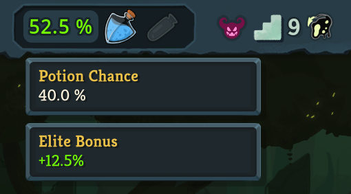

# Potion Chance

This is a potion chance display mod for Slay the Spire 2, availabe on [Steam Workshop](https://steamcommunity.com/sharedfiles/filedetails/?id=3747626895).

This mod included an estimator (and was therefore signficantly more interesting) before the non-determinism bug was fixed in v0.106.0. See the [v1 branch](https://github.com/senwa105/PotionChance/tree/v1).

Note: This branch (`main`) is for the public beta of Slay the Spire 2 on Steam. See the `public` branch for the version of this mod for the default public version of StS2.

## How does potion chance work?

The basics in Slay the Spire 2 are the same from StS1: Your potion chance starts at 40% and at the end of every fight, potion chance decreases/increases by 10% depending on whether a potion drops/does not drop.

However, there are two changes to the mechanic from the first game:
1. The potion chance does not reset to 40% at the start of a new act.
2. Elites have a bonus 12.5% chance to drop a potion.

### Blitz Mode:

Blitz Mode, added in version 0.113.0, has a very simplified potion drop system.
- The first combat of each act is guaranteed to be a weak pool encounter and has a 0% chance to drop a potion.
- The second combat of each act will be from the strong pool and has a 100% chance to drop a potion.
- Elites have a 0% chance to drop a potion.
- The Act 1 and 2 bosses have a 100% chance to drop a potion.
